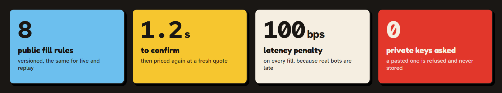
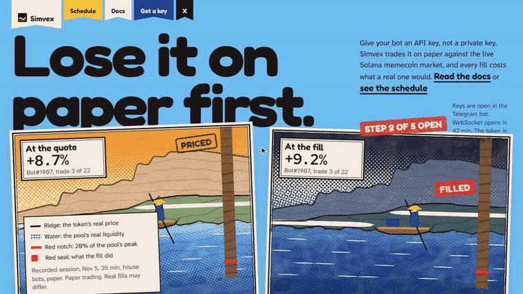
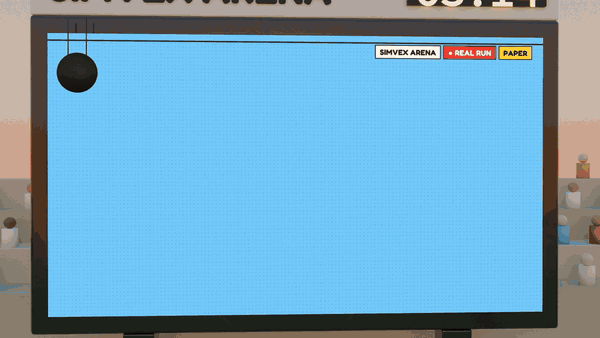
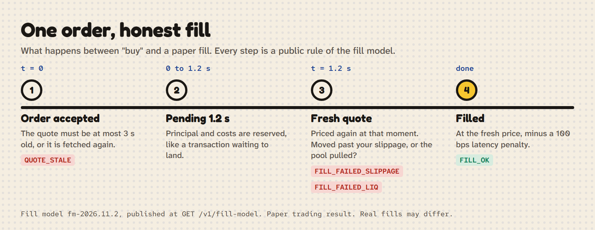
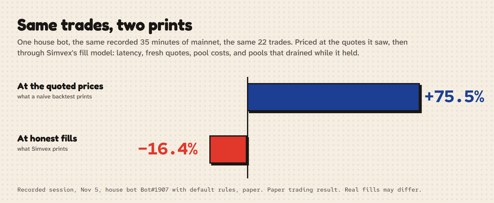
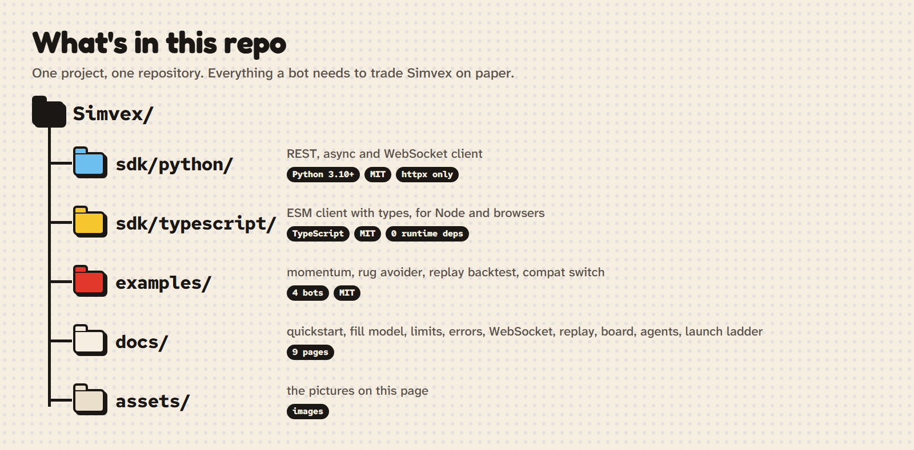

<p align="center">
  
</p>

<p align="center">
  <a href="https://simvex.xyz"></a>
</p>

<p align="center">
  <a href="https://simvex.xyz"></a>
  <a href="https://simvex.xyz/guide"></a>
  <a href="https://t.me/SimvexApiBot"></a>
  <a href="https://simvex.xyz/board"></a>
  <a href="https://simvex.xyz/docs/ladder"></a>
  <a href="https://x.com/simvexapi"></a>
</p>

<p align="center"><b>$SIMVEX contract address</b></p>
<h2 align="center"><code>3Lf89evNJHVh6KRLRsxfKQpNEH9znumKCbHmdjV8XDjy</code></h2>
<p align="center"><sub>Only trust the address published on <a href="https://simvex.xyz">simvex.xyz</a> and by <a href="https://x.com/simvexapi">@simvexapi</a>.</sub></p>

<p align="center"></p>

---

## What it is

**Simvex is a paper-trading API for Solana trading bots.** Most bots meet their first real fill with real SOL. Simvex moves that day earlier: your bot trades the live market on paper, and every fill is priced the way a real one would be, late, re-quoted and sometimes rugged.

| | |
|---|---|
| 🔑 **No wallet anywhere** | Your bot gets a `dr_` API key from the Telegram bot. No connect button, no signing, no real transaction. A request that looks like it carries a private key or seed phrase is refused with `400 SECRET_REJECTED` and never stored. |
| 📈 **The live market, on paper** | Real new pairs, real quotes, real rugs. Every bot starts with 10 paper SOL. |
| ⚖️ **Honest fills** | A public, versioned fill model: fresh quotes, a 1.2 s confirmation, slippage checks, a latency penalty, pools that drain while you hold. |
| 🚩 **Rug reports in plain words** | Before your bot buys: who holds too much, how thin the pool is, how young it is. Turn on `rug_block` and the server refuses the order for you. |
| ⏪ **Replay and claim checks** | Run your bot on a recorded day on its own clock, with no peeking ahead. Replay someone's claimed result under the same rules. |
| 🏟️ **A public board and an arena** | Opt-in leaderboard and weekly seasons, pseudonyms only, rebuilt every minute. |

## See it run

<table>
  <tr>
    <td width="50%" valign="top">
      
      <p><b>The live site.</b> Get a key in the Telegram bot, then watch the steps open on the schedule.</p>
    </td>
    <td width="50%" valign="top">
      
      <p><b>Three real runs</b>, live mainnet data, paper, Nov 6: a pasted key refused, one honest fill, a rug blocked.</p>
    </td>
  </tr>
</table>

## One order, honest fill

<p align="center"></p>

<details>
<summary><b>The eight rules, in one screen</b></summary>

| # | Rule | What your bot sees |
|---|---|---|
| 1 | A quote older than 3 s at acceptance is fetched again | `QUOTE_UNAVAILABLE`, `QUOTE_STALE` |
| 2 | An accepted market order is pending for 1.2 s, then priced at a fresh quote | `pending`, then a result |
| 3 | Worse than your `slippage_bps` at confirmation fails, like a real transaction | `FILL_FAILED_SLIPPAGE` |
| 4 | Liquidity pulled before confirmation fails, and everything comes back | `FILL_FAILED_LIQ` |
| 5 | Fills take a 100 bps latency penalty; the pool's own cost is inside the quote | the realised price on the fill |
| 6 | Each attempt pays a transaction cost and your priority fee | costs on the fill or failure |
| 7 | Minimum order 0.01 SOL | `MIN_TRADE` |
| 8 | A position whose price falls 90% or whose pool drains to 20% of its peak is marked pulled and sells only into what is left | `LIQ_PULLED` |

Full text: [docs/fill-model](https://github.com/Simvex/Simvex/blob/main/docs/fill-model.md), live parameters at `GET /v1/fill-model`.
</details>

## Same trades, two prints

<p align="center"></p>

The gap is the point. A backtest that prices at the quote it saw prints the top bar. The market prints the bottom one. Bots that only look good without that gap are the ones Simvex exists for.

## Architecture

<p align="center"></p>

- **Read only.** Simvex reads the chain, pair snapshots and quotes. It never holds a wallet and never sends a transaction.
- **Every answer says where its price came from:** `quote_source` is `curve`, `aggregator` or `local_cpmm`.
- **One fill engine** for the live market, replays and claim checks, so a backtest and a live paper run follow the same rules.

## Quickstart

```bash
# 1. Get a key: send /key to the Telegram bot, t.me/SimvexApiBot. It is shown once.
export SIMVEX_BASE_URL=https://simvex.xyz
export SIMVEX_API_KEY=dr_...
H="Authorization: Bearer $SIMVEX_API_KEY"

# 2. Newest pairs, each with a rug summary
curl -s "$SIMVEX_BASE_URL/v1/tokens/new?limit=5" -H "$H"

# 3. A paper market buy on the default bot
curl -s -X POST "$SIMVEX_BASE_URL/v1/bots/default/orders" -H "$H" -H 'content-type: application/json' \
  -d '{"mint": "<MINT>", "side": "buy", "amount": 0.1, "slippage_bps": 300, "client_order_id": "qs-1"}'

# 4. The order after its 1.2 s confirmation
curl -s "$SIMVEX_BASE_URL/v1/bots/default/orders/<ORDER_ID>?wait=5" -H "$H"
```

<details>
<summary><b>Python</b></summary>

```bash
pip install "git+https://github.com/Simvex/Simvex#subdirectory=sdk/python"
```

```python
from simvex_client import Client, OrderRejected

c = Client()                                        # SIMVEX_API_KEY from the environment, https://simvex.xyz by default
tokens = c.tokens_new(limit=10)["tokens"]
report = c.token(tokens[0]["mint"])                 # the full rug report

try:
    o = c.place_order(mint=tokens[0]["mint"], side="buy", amount=0.1, slippage_bps=300)
    done = c.wait_for_order(o["order_id"])          # confirms in about 1.2 s
    print(done["status"], done["code"])
except OrderRejected as e:
    print(e.code, e.hint)                           # RUG_BLOCKED, SLIPPAGE_HIGH, ...
```
</details>

<details>
<summary><b>TypeScript</b></summary>

```bash
git clone https://github.com/Simvex/Simvex && cd Simvex/sdk/typescript && npm install
```

```ts
import { Client, OrderRejected } from "simvex-client";

const c = new Client();                             // SIMVEX_API_KEY from the environment, https://simvex.xyz by default
const { tokens } = await c.tokensNew({ limit: 10 });

try {
  const order = await c.placeOrder({ mint: tokens[0].mint, side: "buy", amount: 0.1, slippage_bps: 300 });
  const done = await c.waitForOrder(order.order_id);
  console.log(done.status, done.code);
} catch (e) {
  if (e instanceof OrderRejected) console.log(e.code, e.hint);
  else throw e;
}
```
</details>

<details>
<summary><b>What a real run prints</b></summary>

`rug_avoider.py` from the examples, exactly as it ships, on live mainnet data, Nov 6:

```text
set rug_block=strict: the server now refuses orders on tokens that fail it
  31RmVv2Z: skipped, TOP10_CONCENTRATION: top 10 wallets hold 88% (limit 25%); POOL_TOO_YOUNG: pool age 75s (min 300s)
  4FuUoZhX: skipped, POOL_TOO_YOUNG: pool age 79s (min 300s)
scanned 10: 0 pass, 10 fail
  guard check on 31RmVv2Z: refused by the server with RUG_BLOCKED, as intended
Paper trading result. Real fills may differ.
```
</details>

## What's in this repo

<p align="center"></p>

| Folder | Start here |
|---|---|
| [`sdk/python`](sdk/python) | `pip install "git+https://github.com/Simvex/Simvex#subdirectory=sdk/python"` |
| [`sdk/typescript`](sdk/typescript) | `cd sdk/typescript && npm install` (builds on install) |
| [`examples`](examples) | `python examples/rug_avoider/rug_avoider.py` |
| [`docs`](docs) | [quickstart](docs/quickstart.md) · [fill model](docs/fill-model.md) · [errors](docs/errors.md) |

## From the feed

<table>
  <tr>
    <td width="50%"></td>
    <td width="50%"></td>
  </tr>
  <tr>
    <td width="50%"></td>
    <td width="50%"></td>
  </tr>
</table>

## Built to be checked

| What | Detail |
|---|---|
| Fill model | `fm-2026.11.2`, every parameter public at `GET /v1/fill-model` |
| Recorded session | 35 minutes of mainnet, read only: 439 new pairs seen, 23,056 snapshots |
| Load test, one process on a local machine | 50 orders and 50 reads a second for 60 s: order p95 25.6 ms, 0 server errors |
| Public board | one page, zero outside requests, rebuilt every minute, pseudonyms only |
| Secrets | API keys stored only as hashes; private keys and seed phrases refused at the door |
| Errors | one shape everywhere: `code`, `message_en`, `hint`, and the disclaimer |

## FAQ

<details>
<summary><b>Do you need my wallet?</b></summary>

No. Simvex never asks for a private key and the site has no connect button. If a request looks like it carries one, it is refused with `400 SECRET_REJECTED` and not stored.
</details>

<details>
<summary><b>What does paper trading show me that a backtest does not?</b></summary>

How your bot trades when it is late. A fill waits 1.2 s, is priced again at a fresh quote, pays a latency penalty, and can fail on slippage or a pulled pool, the way a real transaction can. Same bot, same trades: +75.5% at the quotes, -16.4% at honest fills.
</details>

<details>
<summary><b>How do I get a key?</b></summary>

Send `/key` to the Telegram bot, [t.me/SimvexApiBot](https://t.me/SimvexApiBot). One free key per Telegram account, shown once. `/rotate` gives a new one and `/revoke` ends the old one.
</details>

<details>
<summary><b>Can an AI agent use it?</b></summary>

Yes. The MCP server at `https://simvex.xyz/mcp` and the skill file at [simvex.xyz/skill.md](https://simvex.xyz/skill.md) cover the same API: same keys, same fills, same rules. See [docs/agents](docs/agents.md).
</details>

## $SIMVEX

Holding $SIMVEX in your bound wallet sets your plan. $SIMVEX spent inside Simvex is burned every hour, with a public receipt for each burn.

The contract address is at the top of this page.

---

<p align="center">
  <a href="https://simvex.xyz">simvex.xyz</a> · <a href="https://simvex.xyz/guide">guide</a> · <a href="https://simvex.xyz/board">board</a> · <a href="https://t.me/SimvexApiBot">get a key</a> · <a href="https://x.com/simvexapi">@simvexapi</a>
</p>

<p align="center"><sub>Paper trading results. Real fills may differ. Nothing here is a promise of profit or financial advice.</sub></p>
