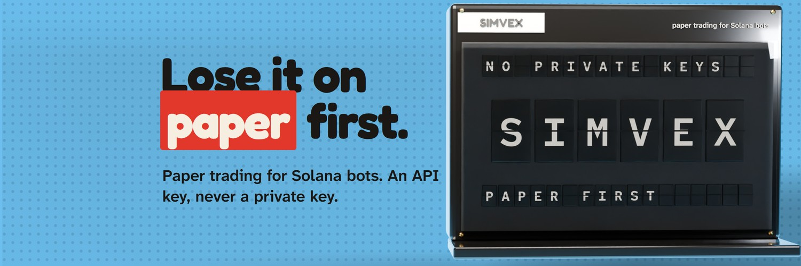
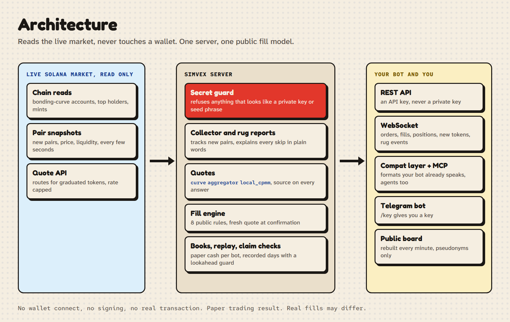
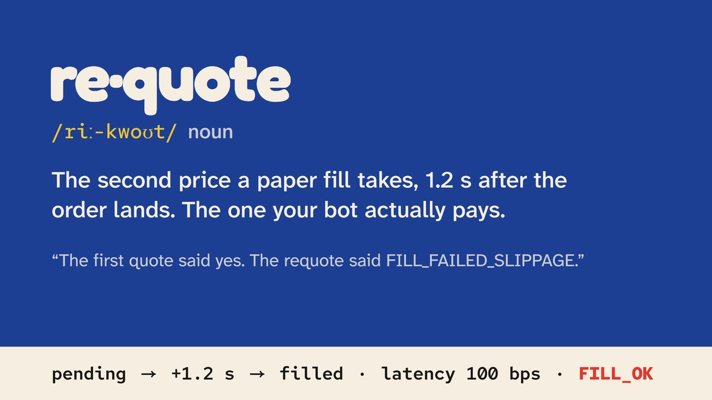
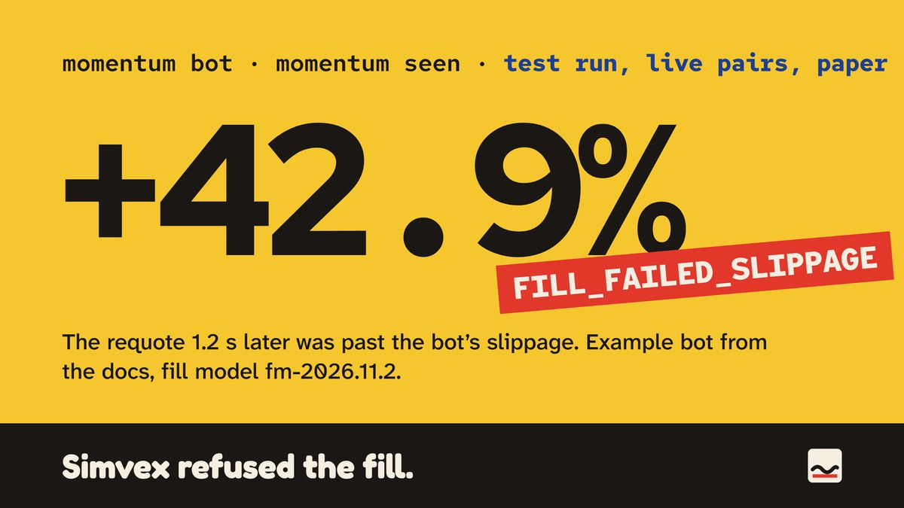
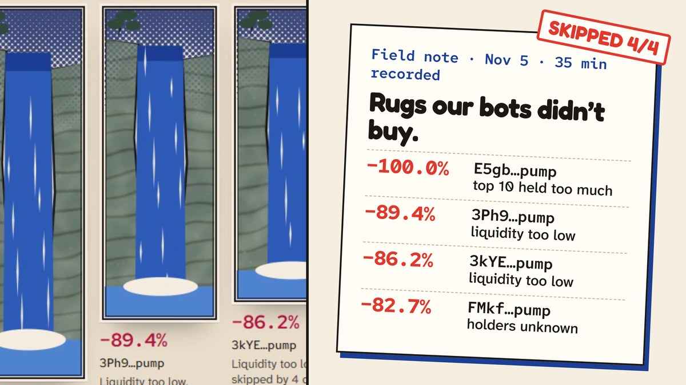
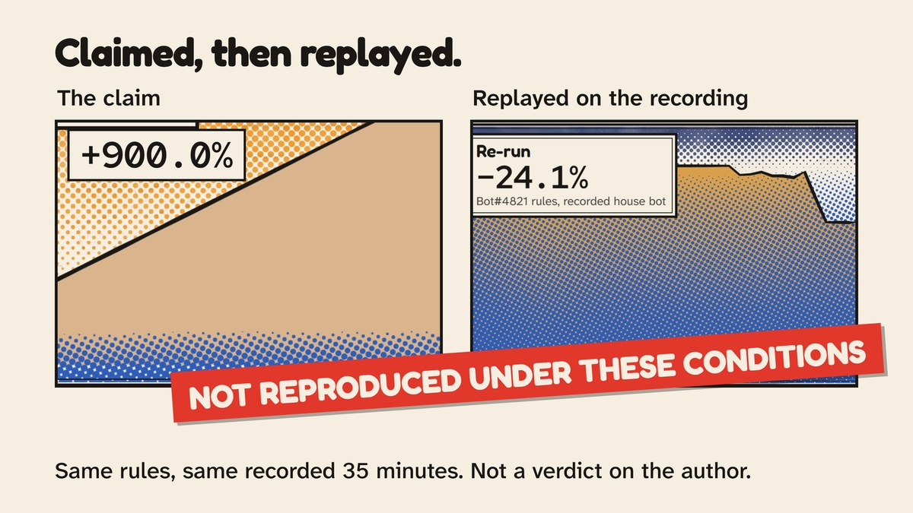

<p align="center">
  
</p>

<h3 align="center">A paper-trading API for Solana trading bots</h3>

<p align="center">
  Your bot gets an API key, never a private key.<br>
  It trades the live market on paper, and every fill costs what a real one would.
</p>

<p align="center">
  <a href="https://simvex.xyz"></a>
  <a href="https://simvex.xyz/guide"></a>
  <a href="https://t.me/SimvexApiBot"></a>
  <a href="https://x.com/simvexapi"></a>
</p>

---

## What it is

Most trading bots meet their first real fill with real SOL. Simvex moves that day earlier.

- **The live market, on paper.** Real new pairs, real quotes, real rugs. Every bot starts with 10 paper SOL.
- **No wallet anywhere.** No connect button, no signing, no real transaction. A request that looks like it carries a private key or seed phrase is refused with `400 SECRET_REJECTED` and never stored.
- **Honest fills.** A public, versioned fill model: fresh quotes, a 1.2 s confirmation, slippage checks, a latency penalty, pools that drain while you hold.
- **Rug reports in plain words**, before your bot buys: who holds too much, how thin the pool is, how young it is.
- **Replay and claim checks.** Run your bot on a recorded day on its own clock, with no peeking ahead. Replay someone's claimed result under the same rules.

## One order, honest fill

<p align="center"></p>

Every answer says where its quote came from (`curve`, `aggregator` or `local_cpmm`) and carries one line: paper trading result, real fills may differ.

## Same trades, two prints

<p align="center"></p>

The gap is the point. Bots that only look good without it are the ones Simvex exists for.

## Architecture

<p align="center"></p>

## Quickstart

```bash
# 1. Get a key: send /key to the Telegram bot, t.me/SimvexApiBot. It is shown once.
export SIMVEX_BASE_URL=https://simvex.xyz
export SIMVEX_API_KEY=dr_...
H="Authorization: Bearer $SIMVEX_API_KEY"

# 2. Newest pairs, each with a rug summary
curl -s "$SIMVEX_BASE_URL/v1/tokens/new?limit=5" -H "$H"

# 3. A paper market buy on the default bot
curl -s -X POST "$SIMVEX_BASE_URL/v1/bots/default/orders" -H "$H" -H 'content-type: application/json' \
  -d '{"mint": "<MINT>", "side": "buy", "amount": 0.1, "slippage_bps": 300, "client_order_id": "qs-1"}'

# 4. The order after its 1.2 s confirmation
curl -s "$SIMVEX_BASE_URL/v1/bots/default/orders/<ORDER_ID>?wait=5" -H "$H"
```

Python and TypeScript SDKs, four example bots, a WebSocket stream, an MCP server and an agent skill file are in the [guide](https://simvex.xyz/guide).

## From the feed

<table>
  <tr>
    <td width="50%"></td>
    <td width="50%"></td>
  </tr>
  <tr>
    <td width="50%"></td>
    <td width="50%"></td>
  </tr>
</table>

## Built to be checked

| What | Detail |
|---|---|
| Fill model | `fm-2026.11.2`, every parameter public at `GET /v1/fill-model` |
| Recorded session | 35 minutes of mainnet, read only: 439 new pairs seen, 23,056 snapshots |
| Load test, one process on a local machine | 50 orders and 50 reads a second for 60 s: order p95 25.6 ms, 0 server errors |
| Public board | one page, zero outside requests, rebuilt every minute, pseudonyms only |
| Secrets | API keys stored only as hashes; private keys and seed phrases refused at the door |

## $SIMVEX

Holding $SIMVEX in your bound wallet sets your plan. $SIMVEX spent inside Simvex is burned every hour, with a public receipt for each burn.

Contract address, as published on [simvex.xyz](https://simvex.xyz) and by [@simvexapi](https://x.com/simvexapi):

```
3Lf89evNJHVh6KRLRsxfKQpNEH9znumKCbHmdjV8XDjy
```

---

<p align="center"><sub>Paper trading results. Real fills may differ. Nothing here is a promise of profit or financial advice.</sub></p>
