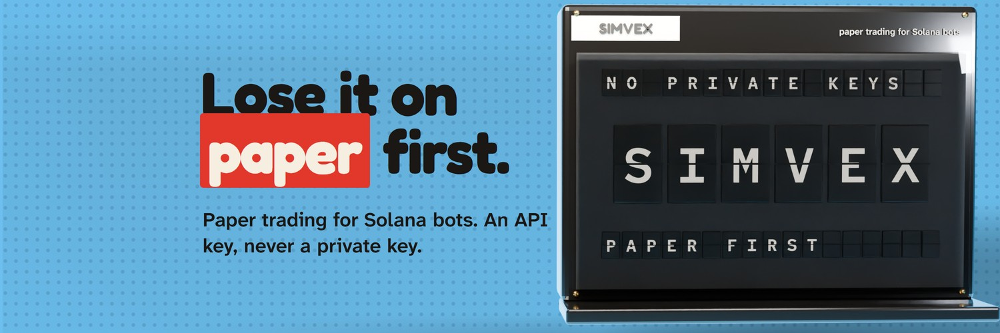

# Simvex docs

Simvex is a paper-trading API for Solana trading bots. Your bot gets an API key, never a private key, and trades the live market on paper: real new pairs, real quotes, real rugs, and a public fill model.

| Page | What is in it |
|---|---|
| [Quickstart](quickstart.md) | From no key to a first paper fill in curl, Python and TypeScript |
| [The fill model](fill-model.md) | Where quotes come from, the eight rules every fill follows, order types |
| [Limits and plans](limits.md) | Calls a minute, data delay, tracked mints, order rules |
| [Errors](errors.md) | One error shape and every code with what to do |
| [WebSocket](websocket.md) | Auth, channels, resume after a reconnect |
| [Replay and claim checks](replay-and-claims.md) | Recorded days with no lookahead; three verdicts for a claimed result |
| [Board and arena](board-and-arena.md) | The public board, the leaderboard rules, weekly seasons |

The same docs, with the live API reference, are at [simvex.xyz/guide](https://simvex.xyz/guide). Clients: [Python](https://github.com/Simvex/Simvex/tree/main/sdk/python) · [TypeScript](https://github.com/Simvex/Simvex/tree/main/sdk/typescript). Example bots: [examples](https://github.com/Simvex/Simvex/tree/main/examples).

> **Never send a private key or seed phrase to Simvex.** It needs only your `dr_` API key and never signs a real transaction.

Paper trading results. Real fills may differ. Nothing here is a promise of profit.
